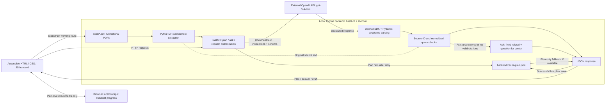

# ScanReady: System Architecture Image Prompt

## Asset Brief

- **Output filename:** `05_system_architecture.png`
- **Format:** landscape PNG, ideally 3840 x 2160, 16:9.
- **Purpose:** show judges the actual document-to-plan workflow, structured output parsing, and code-level quote checks.
- **Caption:** *ScanReady technical architecture showing text extraction, LLM structured schema enforcement, and quote validation.*

## Copy-Ready Image Generation Prompt

Copy the entire block below into the image-generation model. Generate a diagram, not a decorative illustration. If a reference image is supported, supply a screenshot of the real ScanReady interface for color reference only.

```text
Create a polished, technically accurate system architecture diagram for
"ScanReady", a patient-side imaging appointment preparation prototype.

DELIVERABLE
One landscape 16:9 architecture image, 3840 x 2160 PNG. All text must be
sharp, correctly spelled, and readable at presentation size. Use a flat,
vector-style technical diagram with meaningful symbols and labeled arrows.
This is a real software architecture, not a marketing poster or app mockup.

TITLE
ScanReady | System Architecture
Subtitle: From fictional PDF documents to a source-linked preparation plan

VISUAL LANGUAGE
White background, dark charcoal text, teal primary connectors (#1b7f8c),
subtle gray boundary lines, and pale teal processing nodes. Use restrained
amber for human-confirmation and fallback paths, and muted red only for
discarded items. Use a clean technical sans-serif typeface. No gradients,
glowing circuits, robots, AI brains, decorative hospital imagery, 3D blocks,
or excessive shadows. Use generous spacing and a consistent stroke weight.
Make the main flow visually dominant; keep secondary notes smaller.

Use recognizable outline symbols:
- stacked pages with folded corners for the PDF bundle;
- a document with text lines for extraction;
- a server with small route branches for FastAPI;
- a cloud with an API connector for OpenAI;
- curly braces and a checklist for the Pydantic schema parser;
- a shield with a magnifying glass for quote checks, NOT a medical approval seal;
- a phone/browser outline for the frontend;
- a file icon for saved JSON and a small lock for the backend API key.
Use symbols alongside text, never instead of labels. Avoid invented logos.

COMPOSITION
Use three clearly labeled areas:
1. A browser area across the top.
2. A large outlined "Local Python backend | FastAPI + Uvicorn" area below it.
3. A separate "External service" area to the right, containing OpenAI.

Inside the local backend area, arrange the main data pipeline horizontally:
PDF bundle -> PyMuPDF extraction -> FastAPI orchestration -> Pydantic parser
-> Quote validation -> JSON response.

Place the OpenAI cloud above and to the right of FastAPI orchestration,
outside the local backend boundary. Connect orchestration to OpenAI with
"Document text + instructions + schema". Connect OpenAI to the Pydantic
parser with "Structured response". Do NOT draw a direct orchestration-to-parser
arrow that bypasses OpenAI; the visual pipeline crosses the cloud and returns.

Place the frontend at the top with two clearly separate arrow connections:
- Frontend -> FastAPI orchestration: "HTTP requests".
- JSON response -> Frontend: "Plan / answer / request draft".

NODE CONTENT: USE THESE EXACT SHORT LABELS

PDF bundle:
"5 fictional sample PDFs"
"docs/*.pdf"
Use five small page symbols labeled:
Referral | Appointment | Preparation | Accessibility | Insurance

Extraction:
"PyMuPDF"
"Extract text + document IDs"
Small secondary note: "In-memory extraction cache"

Orchestration:
"FastAPI orchestration"
"Plan | Ask | Draft"
Small secondary note: "Document-only prompts"

External service:
"OpenAI API"
"gpt-5.4-mini"
Small secondary note: "Backend-only API key"
Show a lock beside this note, not beside the browser.

Parser:
"Structured output parsing"
"OpenAI SDK + Pydantic"
Small secondary note: "Plan / Answer / DraftRequest"

Quote validation:
"Quote validation layer"
"Known source ID + text match"
Small secondary note: "Normalize case, whitespace and quotes"
Add a small red branch from this node labeled:
"Nonmatching tasks, blockers and citations dropped"

JSON response:
"JSON response"
"Filtered items + source references"

Frontend:
"Accessible frontend"
"HTML / CSS / JavaScript"
Within the browser outline, show three compact rows, not a realistic screenshot:
"Source-linked plan and PDFs"
"Checklist progress + question prompts"
"Copy request + print plan"
Small secondary note: "Semantic HTML | Labeled controls | Visible focus"
Show a checkbox symbol and a small progress bar as part of the browser outline.

IMPORTANT ADDITIONAL CONNECTIONS
Draw a thin dotted arrow from PyMuPDF extraction to Quote validation labeled
"Original extracted text". This shows that quote checks use the source corpus,
not another AI call.

Below Quote validation, add a small amber branch for the Ask workflow:
"Documents do not answer, or no citation survives"
-> "Fixed won't-guess reply + question for the center"
-> JSON response.

Below orchestration, add a file-shaped side node:
"Saved plan | backend/cache/plan.json"
Connect the successful live plan response to this file with a thin arrow:
"Save live plan".
Connect orchestration to this file with a dashed amber arrow:
"Plan generation fails after retry".
Connect the saved file back to JSON response with a dashed amber arrow:
"Fallback, when available; labeled saved sample".
Keep this visually secondary. It is a plan-only fallback, not a fallback for
questions or request drafts.

Draw a small document-viewing branch directly from the browser to the local
PDF bundle, labeled "GET /documents/{filename}". This is a static file view,
not an AI workflow and not an upload workflow.

Near the browser, show a small storage chip labeled:
"Browser localStorage: personal checklist progress".
Do not draw a server database. Do not imply the entire plan is persisted in
browser storage or that checkmarks represent clinical clearance.

BOTTOM STRIP
Use three compact text callouts:
"PDF text is sent to OpenAI"
"Patient reviews and sends requests"
"Fictional demo documents; not medical advice"

LEGEND
Solid arrow: main request / data flow
Dotted arrow: source text used for checking
Dashed amber arrow: saved-plan fallback

ACCURACY CONSTRAINTS
Do not add uploads, OCR, embeddings, vector search, a database, authentication,
hospital integrations, electronic health records, automatic email sending,
an AI agent network, or a second AI validation model. These are not implemented.
Do not label the whole output as verified or hallucination-free.
Schema parsing checks structure; quote matching checks source text occurrence.
It does not prove that a generated claim is supported by its attached quote.
The appointment headline does not have a quote-matching check. Discrepancies
have document-ID checks only. Request-draft text is not independently fact-checked;
its supporting citations are filtered. Keep these limitations in a small,
readable footnote: "Quote matching checks evidence text, not every claim."

FINAL QUALITY CHECK
Every arrow has an unambiguous direction and adequate clearance from text.
No connectors cross node labels. No duplicated nodes or misspelled technology
names. OpenAI is outside the local backend boundary. PDF extraction, schema
parsing, and quote validation are visibly separate steps. The title and main
pipeline remain readable when the image is scaled to 1920 x 1080.
```

## Architecture Reference

Use this as a factual reference when reviewing the generated image. The current code takes precedence over older planning documents, particularly for browser checklist storage and extraction caching.



## Implementation Evidence

| Component | Implemented In | What To Show Accurately |
|---|---|---|
| PDF intake | [documents.py](../backend/app/documents.py) | Local PDF files, PyMuPDF text extraction, filename IDs, process-local cache; no upload or OCR. |
| API and static files | [main.py](../backend/app/main.py) | FastAPI API endpoints, frontend serving, and direct PDF viewing. |
| AI invocation | [ai.py](../backend/app/ai.py) | Backend-only OpenAI client, `responses.parse`, Pydantic schema; default model `gpt-5.4-mini`, configurable via `OPENAI_MODEL`. |
| Typed output | [models.py](../backend/app/models.py) | `Plan`, `Answer`, and `DraftRequest` schemas. Schema validation is not factual validation. |
| Plan grounding | [plan.py](../backend/app/plan.py) | Drop tasks/blockers with missing or nonmatching quotes; check discrepancy document IDs; retry once before saved fallback. |
| Question safety | [ask.py](../backend/app/ask.py) | Filter citations; require the model's answered flag, nonempty answer, and surviving citations; otherwise use fixed refusal text. |
| Draft grounding | [draft.py](../backend/app/draft.py) | Filter supporting citations; patient reviews and sends the message. |
| Frontend | [app.js](../frontend/app.js), [index.html](../frontend/index.html), [styles.css](../frontend/styles.css) | PDF links, tasks, local checkbox progress, questions, copy request, print layout, accessible controls. |

## Review Before Publishing

- Confirm that the model name is spelled `gpt-5.4-mini`, not a substituted model.
- Make sure the diagram sends document text to OpenAI; do not imply local-only processing.
- Confirm that OpenAI returns through structured parsing and quote checks, not straight to the browser.
- Keep saved-plan fallback distinct from the browser's personal checklist storage.
- Reject claims such as "zero hallucinations", "all facts verified", or "clinically validated".
- If the image model struggles with labels, generate the icon/layout draft first and typeset these exact labels in a slide or diagram editor. Accurate text matters more than decorative polish.
- Export the final asset as `05_system_architecture.png` and use the caption from the Asset Brief.